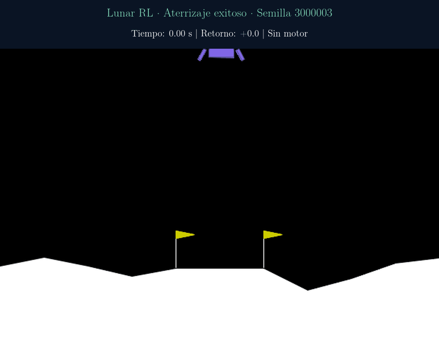
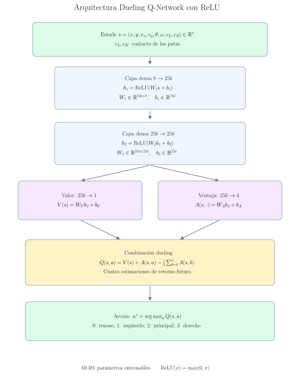
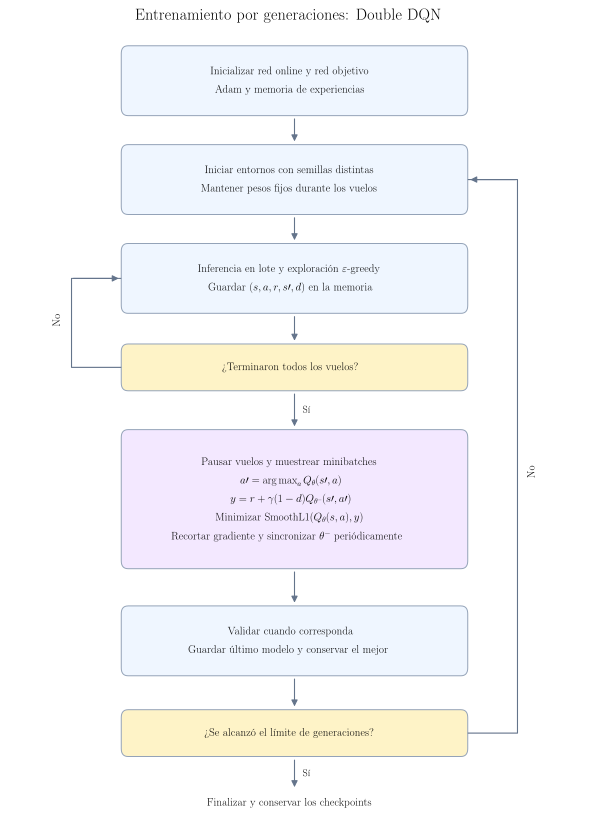
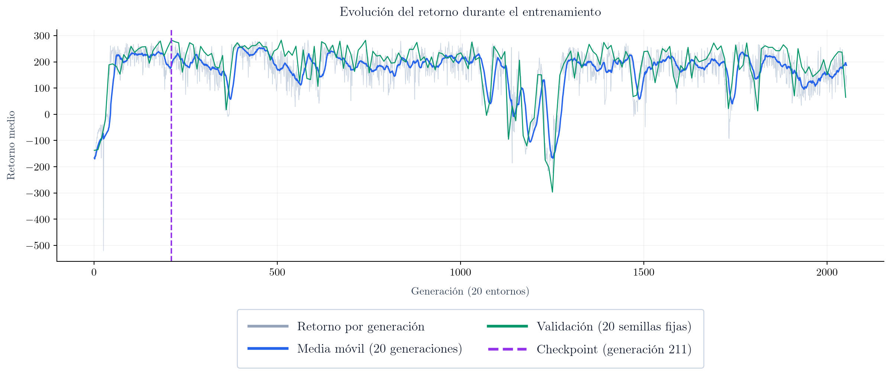
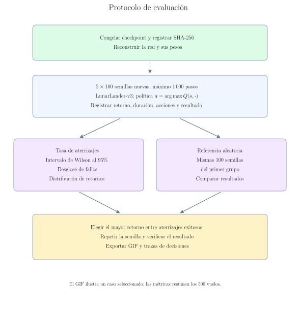
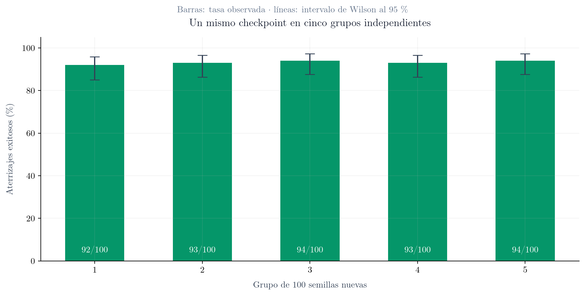
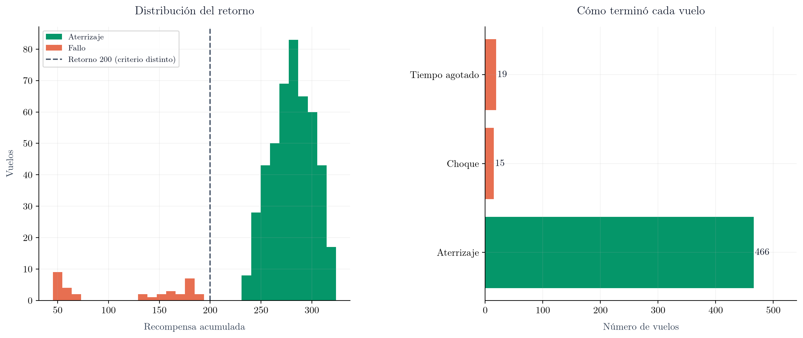
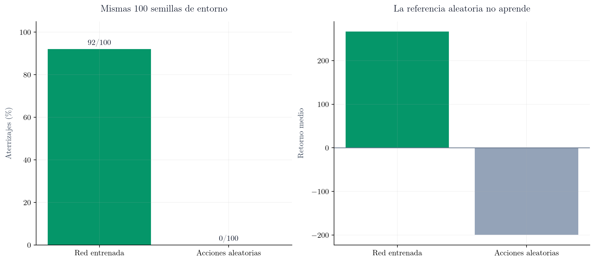
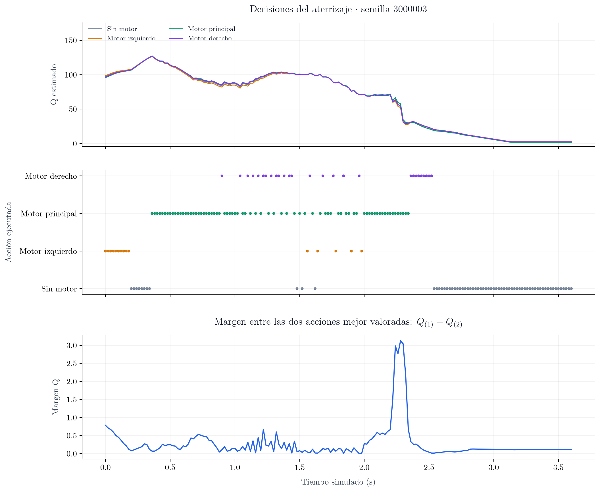
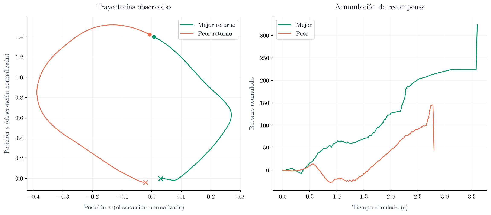

# Lunar RL · Dueling Double DQN para aterrizaje autónomo

**Una red ReLU, 20 entornos por generación y una evaluación reproducible sobre 500 escenarios nuevos.**

> **Resultado medido: 93.2 % de aterrizajes exitosos (466/500).**
> Pesos congelados, acciones sin exploración y cinco grupos de semillas distintos.

<div align="center">

<p><em>Ejemplo seleccionado: mayor retorno entre los aterrizajes exitosos de esta evaluación. No representa un vuelo promedio.</em></p>
</div>

## 1. Motivación y alcance

El objetivo es estudiar cómo una red neuronal aprende a controlar un módulo de aterrizaje mediante recompensas: corregir su posición, reducir la velocidad y completar el descenso. El entorno es **LunarLander-v3 de Gymnasium**, con cuatro acciones discretas y ocho observaciones.

El experimento separa tres preguntas: cómo se construyó la red, cómo se recogieron las experiencias y qué resultados obtuvo un checkpoint concreto en escenarios que no se usaron para seleccionarlo. El rendimiento se presenta con fallos, incertidumbre y datos reproducibles, además de una animación ilustrativa.

## 2. Marco experimental y checkpoint

| Propiedad | Valor documentado |
|---|---|
| Algoritmo | Double DQN con arquitectura dueling |
| Capas compartidas | 8 → 256 → 256 |
| Activación | ReLU en ambas capas ocultas |
| Cabezas | Valor escalar V(s) y cuatro ventajas A(s,a) |
| Parámetros entrenables | 69.381 |
| Optimizador y learning rate del experimento | Adam · 0,0001 |
| Entornos por generación | 20 |
| Checkpoint seleccionado | `best.pt`, congelado como `evaluacion/datos/modelo_evaluado.pt` |
| Generación del checkpoint | 211 |
| Vuelos de entrenamiento hasta ese checkpoint | 4220 |
| Pasos / actualizaciones hasta ese checkpoint | 1752767 / 438119 |

La selección de `best.pt` se hizo durante el entrenamiento mediante retorno medio en **20 semillas fijas de validación (100000–100019)**. Las 500 pruebas publicadas aquí son posteriores y no se utilizan para actualizar pesos ni volver a seleccionar el checkpoint.

Identificador exacto del checkpoint:

```text
0fae98eb963cf977ad5e11a8bb3976abc471c9ea4724377809966b81f1bc6627
```

## 3. Arquitectura formal e inferencia

<div align="center">

</div>

La observación es $s=(x,y,v_x,v_y,\theta,\omega,c_L,c_R)\in\mathbb{R}^8$. Las posiciones y velocidades se reciben en la representación del entorno. Los dos últimos valores indican contacto de las patas.

$$
h_1=\mathrm{ReLU}(W_1s+b_1),\qquad
h_2=\mathrm{ReLU}(W_2h_1+b_2).
$$

$$
V(s)=W_Vh_2+b_V,\qquad A(s,\cdot)=W_Ah_2+b_A.
$$

$$
Q(s,a)=V(s)+A(s,a)-\frac{1}{4}\sum_{b=0}^{3}A(s,b),\qquad
\pi(s)=\arg\max_{a\in\{0,1,2,3\}}Q(s,a).
$$

| Acción | Significado |
|---|---|
| 0 | No encender motores |
| 1 | Motor lateral izquierdo |
| 2 | Motor principal |
| 3 | Motor lateral derecho |

Los valores Q estiman retorno futuro descontado: **no son probabilidades de acierto**. La clase de entrenamiento `QNetwork(nn.Module)` y la activación editable `MiActivacion` están en [lunar_rl.py](lunar_rl.py). La clase `RedEvaluada` de [verificar.py](evaluacion/verificar.py) reproduce esta arquitectura congelada y carga estrictamente sus pesos, para que editar después la red de entrenamiento no cambie esta evaluación.

## 4. Aprendizaje por generaciones

<div align="center">

</div>

Cada generación inicia varios entornos independientes. Todos usan la misma red, cuyos pesos permanecen fijos mientras vuelan; las observaciones se procesan en un lote. Los cohetes terminados esperan al resto. Después se pausa la simulación y se aprende con minibatches de la memoria de experiencias, que también incluye generaciones previas.

La exploración ε-greedy aporta acciones aleatorias durante el entrenamiento. En evaluación se usa exclusivamente `argmax`. La física de la implementación local se ejecuta por turnos en un proceso.

El objetivo Double DQN separa selección y valoración:

$$
a'=\arg\max_a Q_\theta(s',a),\qquad
 y=r+\gamma(1-d)Q_{\theta^-}(s',a').
$$

Aquí $d$ representa una terminación real; un límite de tiempo no se convierte automáticamente en una terminación del problema. Se minimiza SmoothL1 entre el valor predicho y el objetivo, con recorte de gradiente y actualización periódica de la red objetivo.



*La curva presenta el retorno registrado durante el entrenamiento. La línea morada marca el checkpoint evaluado; el entrenamiento continuó después.*

## 5. Protocolo de evaluación

<div align="center">

</div>

- **500 vuelos:** cinco bloques de 100 semillas, definidos antes de ejecutar las pruebas.
- Mismo checkpoint, sin actualizaciones, sin exploración: **ε = 0**.
- `LunarLander-v3`, acciones discretas, gravedad −10, viento desactivado y límite de **1.000 pasos**.
- **Acierto:** el episodio termina con el módulo en reposo, sin choque (`game_over`) y sin salida lateral. El tiempo agotado cuenta como fallo. No se exige una posición exacta entre las banderas.
- Se registra por separado el criterio `retorno ≥ 200`. En esta muestra coincide en número con los aterrizajes, pero son métricas distintas.
- Intervalos de Wilson al 95 % para la tasa de acierto. Describen incertidumbre de muestreo para este checkpoint y distribución, no variabilidad entre entrenamientos.

Los rangos nuevos comienzan en uno, dos, tres, cuatro y cinco millones: están separados de las semillas registradas de entrenamiento y validación. No se garantiza robustez frente a viento, otras gravedades u otras versiones del simulador.

## 6. Resultados obtenidos

| Grupo | Semillas | Aterrizajes | Acierto | Retorno medio |
|---|---|---:|---:|---:|
| 1 | 1000000–1000099 | 92/100 | 92.0 % | 266.40 |
| 2 | 2000000–2000099 | 93/100 | 93.0 % | 270.65 |
| 3 | 3000000–3000099 | 94/100 | 94.0 % | 270.33 |
| 4 | 4000000–4000099 | 93/100 | 93.0 % | 271.46 |
| 5 | 5000000–5000099 | 94/100 | 94.0 % | 269.37 |
| **Total** | **500 escenarios** | **466/500** | **93.2 %** | **269.64** |

| Métrica agregada | Resultado |
|---|---:|
| Intervalo de Wilson al 95 % | 90.65–95.09 % |
| Fallos | 34/500 · 6.8 % |
| Choques | 15 |
| Tiempo agotado | 19 |
| Retorno medio ± desviación estándar | 269.64 ± 48.04 |
| Mediana del retorno | 279.75 |
| Vuelos con retorno ≥ 200 | 466/500 |





**Referencia aleatoria:** sobre las mismas 100 semillas del grupo 1, la red logró **92/100** aterrizajes; elegir uniformemente entre las cuatro acciones logró **0/100**, con retorno medio **-199.53**. La comparación usa los mismos escenarios para ambas políticas.



Los datos de cada vuelo están en [resultados.csv](evaluacion/datos/resultados.csv); el resumen completo y las versiones están en [resumen.json](evaluacion/datos/resumen.json).

## 7. Qué decidió la red



La figura presenta tres lecturas del mismo vuelo del GIF:

1. **Valores Q:** cómo valora las cuatro acciones antes de ejecutarlas.
2. **Acción elegida:** motor seleccionado en cada paso mediante `argmax`.
3. **Margen Q:** diferencia entre los dos mejores valores. Un margen pequeño puede significar que las acciones tienen valor parecido; no demuestra confusión. Un margen grande tampoco garantiza que la acción sea correcta.



*Se muestran el mayor retorno exitoso y el menor retorno de la muestra; los círculos marcan el inicio y las cruces el final. Las coordenadas son observaciones normalizadas, no metros.*

## 8. Animación del mejor aterrizaje observado

El GIF inicial corresponde a la semilla **3000003**, con retorno **323.82** y **181 pasos**. Se eligió el mayor retorno **entre los vuelos exitosos**. Se repitió la semilla y se verificó el mismo resultado antes de exportar.

El archivo tiene **900 × 700 píxeles**, muestrea la simulación a **12,5 fotogramas por segundo** y conserva el tiempo simulado (50 pasos/s), con una pausa final de 1,2 s. Se limita a 128 colores para mantener un tamaño ligero. La figura estática final está en [mejor_aterrizaje.png](evaluacion/fig/mejor_aterrizaje.png).

## 9. Reproducibilidad y organización

```text
evaluacion/
├── verificar.py         # Vuelos, métricas, trazas, GIF y figuras
├── diagramas.py         # Diagramas con fórmulas compiladas por LaTeX
├── documentar.py        # README generado desde los resultados
├── requirements.txt
├── datos/               # Checkpoint congelado, CSV, JSON y trazas NPZ
├── fig/                 # PNG, SVG y PDF; código editable en diagramas.py
└── animation/           # GIF del aterrizaje exitoso
```

El repositorio incluye los resultados, las figuras y el checkpoint evaluado. La reproducción requiere Python 3.12 y las dependencias indicadas. Desde la raíz del proyecto:

```bash
python3 -m venv .venv
.venv/bin/pip install -r requirements.txt -r evaluacion/requirements.txt
.venv/bin/python evaluacion/verificar.py
```

Los archivos `requirements.txt` enumeran únicamente paquetes de Python. La generación de figuras y de los textos del GIF requiere además una instalación de LaTeX con `dvipng`, disponible en el entorno de ejecución.

Para regenerar únicamente figuras, diagramas y README sin repetir vuelos:

```bash
.venv/bin/python evaluacion/verificar.py --solo-figuras
```

Para regenerar el GIF con textos LaTeX:

```bash
.venv/bin/python evaluacion/verificar.py --solo-animacion
```

Las versiones exactas utilizadas están en `evaluacion/datos/entorno.txt` y `resumen.json`. Diferencias de versiones o plataforma pueden cambiar los resultados físicos. El SHA-256 identifica los pesos; los archivos fuente e informes quedan inventariados en `evaluacion/datos/manifiesto.json` para verificar la integridad de los archivos.

Para volver a entrenar, modifica `NUM_GENERATIONS` y `NUM_ENVS` al principio de `lunar_rl.py`. Para evaluar visualmente otros checkpoints, ejecuta `evaluar_modelos.py`. No se necesita entrenar para revisar los resultados publicados.

## 10. Limitaciones y próximos experimentos

Este trabajo evalúa **un único entrenamiento con ReLU y un checkpoint elegido por validación**. Los cinco grupos corresponden a semillas de entorno distintas para la misma red.

La tasa de acierto no es del 100 %: persisten choques y vuelos que no completan el aterrizaje a tiempo. El GIF es una selección favorable, por eso se presenta junto a todos los resultados. Comparaciones futuras deberían mantener las mismas pruebas, incluir varias semillas de entrenamiento y reservar nuevas semillas para una confirmación final si se ajusta el modelo usando este informe.

## 11. Bibliotecas y referencias

- [Gymnasium · LunarLander](https://gymnasium.farama.org/environments/box2d/lunar_lander/): entorno, observaciones, acciones y recompensa.
- [van Hasselt, Guez y Silver · Double Q-learning](https://arxiv.org/abs/1509.06461): selección y valoración separadas del objetivo.
- [Wang et al. · Dueling Network Architectures](https://proceedings.mlr.press/v48/wangf16.html): descomposición valor–ventaja.
- PyTorch: red y carga de pesos. Matplotlib y LaTeX: gráficas y diagramas con fórmulas tipográficas, exportados a PNG, SVG y PDF. Los textos del GIF se compilan con LaTeX; Pillow compone los fotogramas y codifica la animación.

## 12. Créditos de desarrollo

Los entornos gráficos de entrenamiento y evaluación fueron generados con **Codex de OpenAI**.

## 13. Licencia

El código y la documentación propios de este proyecto se ofrecen bajo la [GNU GPL v3.0](LICENSE), Copyright © 2026 Assia-Network. Identificador SPDX: `GPL-3.0-only`. Las bibliotecas y recursos del entorno mantienen sus licencias originales; GPL no sustituye las condiciones de terceros.
